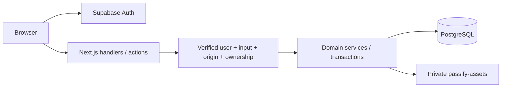
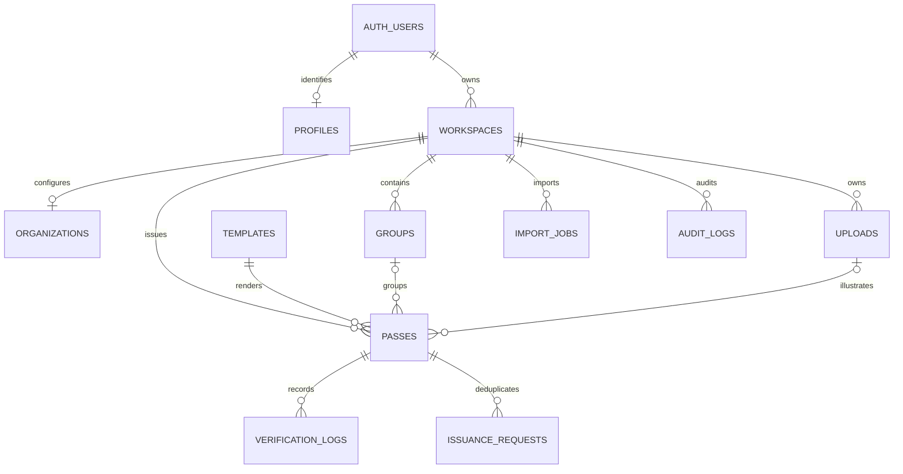

# Backend setup (Phase 1)

Phase 1 provides foundations and migrations. Authentication, onboarding and pass services are
still scheduled for later approval checkpoints. The existing UI is not yet a complete backend.

## Prerequisites

- Node.js 24 LTS and npm. `.nvmrc` and package engines record the runtime.
- Docker Desktop using Linux containers for the local Supabase stack.
- Development/test Supabase projects must be separate from production.

On this Windows machine use `npm.cmd`/`npx.cmd` when PowerShell rejects the `.ps1` shims.

## Local configuration

```powershell
npm.cmd ci
Copy-Item .env.example .env.local
npm.cmd run db:start
npm.cmd run db:migrate
```

`db:start` starts only the repository's local Supabase stack. First start may download images.
The installed Supabase CLI 3 makes `migration up` local by default (the old `--local` flag was removed).
`db:migrate` passes no `--remote` flag; it does not target a linked project or reset data.
Template records are included in versioned migrations, so no separate seed command is needed.
Use `npm.cmd run db:stop` when finished; do not use database reset on a populated instance.

Put actual local values in `.env.local`, never in a chat message, a tracked file, or client code:

| Variable | Purpose |
| --- | --- |
| `NEXT_PUBLIC_SUPABASE_URL` | Local API URL or development project URL |
| `NEXT_PUBLIC_SUPABASE_PUBLISHABLE_KEY` | Public Auth key (legacy local anon JWT is supported) |
| `SUPABASE_SECRET_KEY` | Server-only secret key (legacy local service-role JWT is supported) |
| `APP_URL` | Canonical application origin; no path, query or credentials |
| `ALLOWED_ORIGINS` | Optional comma-separated exact additional app origins; no wildcards |
| `AUTH_SECRET` | Existing HMAC auth only, until Phase 2 replaces it; at least 32 random characters |

Next.js instrumentation validates required backend configuration before serving requests. Placeholder
values are intentionally rejected. Production requires HTTPS for the application, Supabase and allowed
origins. Client public values are bundled at build time, so configure them before building.

Existing JSON-store users are **not** Supabase users. A real-user migration requires a separate approved
plan; Phase 1 does not inspect or alter that file. Until Phase 2, the original auth UI still uses its old
store/cookie and needs `AUTH_SECRET`. Do not treat this checkpoint as production-ready.

## Checks without Docker or credentials

```powershell
npm.cmd run test
npm.cmd run db:types:check
npm.cmd run lint:backend
npm.cmd run typecheck
```

Database tests create a fresh in-memory PostgreSQL instance, install minimal Supabase-managed schema
fixtures, then run the exact migration files. Fixtures create two unrelated owners and test composite
foreign keys, revocation immutability, rollback, roles and Storage policies. Nothing contacts or modifies
a real database. Full Supabase Auth, PostgREST, Storage API and browser flows require the real local
stack in later phases; these tests are not a substitute for those checks.

```powershell
npm.cmd run db:types
```

Regenerates `lib/supabase/database.types.ts` from PostgreSQL catalogs after migrations. Check in the
generated file. The generator fails on unmapped data types; extend it when introducing new types/RPCs.

```powershell
npm.cmd run lint
npm.cmd run build
```

Full checks include the existing frontend; see the phase report for baseline issues and actual results.
Playwright is configured for desktop and mobile. E2E scenarios will be implemented alongside real flows;
`npm.cmd run test:e2e` intentionally fails if no tests exist (there is no pass-with-no-tests flag).

## Data security model



The browser Supabase client is for Auth, not application table queries. Public and authenticated
database roles have no application privileges. Server services use the privileged client only after
checking ownership; its bypass of RLS makes those checks mandatory. Future RPCs must be invoker-safe,
restricted to service role and owner-scoped internally. Do not expose the secret client or key through
`NEXT_PUBLIC_`, props, logging or responses.



All business dates use `timestamptz`. Expiry is derived at read time, not stored as a mutable status.
Uploads use workspace-scoped random paths and database-backed references. File decoding, purpose
validation, signed URLs, safe cleanup and upload compensation are implemented in Phase 2.

## References

- Installed Next.js guides: route handlers, proxy, async cookies, instrumentation, environment variables
  in `node_modules/next/dist/docs/` (read before implementation).
- [Supabase SSR clients](https://supabase.com/docs/guides/auth/server-side/creating-a-client)
- [Supabase row-level security](https://supabase.com/docs/guides/database/postgres/row-level-security)
- [Supabase Storage access control](https://supabase.com/docs/guides/storage/security/access-control)
