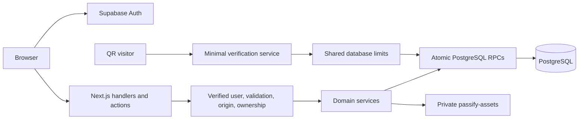
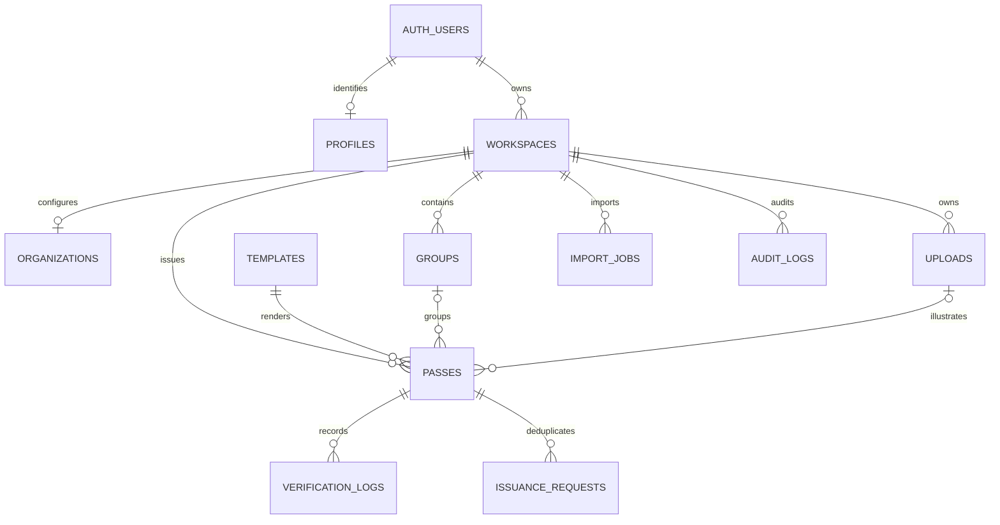

# Setup and architecture

## Environment

Use Node.js 24, npm and Docker Desktop's Linux engine. Run `npm ci`, start Docker, then
`npm run db:start`. Project ID `passify` isolates this stack from other local projects.
First startup downloads images. The smaller stack used for validation can be started with:

```powershell
npx.cmd supabase start --exclude realtime,imgproxy,studio,edge-runtime,logflare,vector,supavisor
```

Copy `.env.example` to `.env.local` once; preserve existing configuration. Fill local keys from
Supabase's startup output. Keep keys and startup logs private.

| Variable | Purpose |
| --- | --- |
| `NEXT_PUBLIC_SUPABASE_URL` | Local `http://127.0.0.1:54321` or dedicated development project |
| `NEXT_PUBLIC_SUPABASE_PUBLISHABLE_KEY` | Public Auth key; local legacy anon JWT supported |
| `SUPABASE_SECRET_KEY` | Server-only key; local legacy service-role JWT supported |
| `APP_URL` | Canonical origin, locally `http://localhost:3000`, no path/query |
| `ALLOWED_ORIGINS` | Optional comma-separated exact additional origins, no wildcards |

Startup validates these values. Production requires HTTPS. Public values are embedded at build
time. `AUTH_SECRET` and the old `passify_session` cookie are obsolete. Old JSON accounts are neither
migrated nor deleted.

Run `npm run db:migrate` and `npm run dev`. Supabase CLI 3's `migration up` is local by default;
the old `--local` flag was removed. This applies pending migrations without resetting data or using
a linked remote project. Five ordered migrations create schema, all template seeds, private bucket
and transaction RPCs. Use `npm run db:stop` when done; do not routinely reset populated databases.

Ports: app 3000, API 54321, PostgreSQL 54322, optional Studio 54323, local email inbox 54324.

## Accounts and tests

Register through either workspace's registration page. Confirmation and recovery email goes to
`http://127.0.0.1:54324`; open its links in the originating browser for PKCE. A signed-in user can
visit the other workspace's login page to create that mode without another account.

`accounts.spec.ts` tests real registration, confirmation, both onboarding flows, private assets,
logout and recovery. `passes.spec.ts` creates unique confirmed local Auth fixtures, then uses real
login, builders, APIs and browser downloads. Both desktop Chromium and Pixel 7 emulation are
configured. Tests reject non-local Supabase targets. Test data remains in the isolated local stack
for inspection. Never run this suite against production.

Install Chromium with `npx playwright install chromium`. Start app/database separately before
`npm run test:e2e -- --workers=1`; the tests do not start them automatically. Test artifacts and
traces are ignored by Git and may contain local session data; do not publish them unredacted.

`npm test` executes unit tests and disposable PGlite PostgreSQL tests against the exact migrations,
roles, constraints, RLS and transactions. Minimal fixtures simulate only Supabase-managed schemas;
real Auth/PostgREST/Storage HTTP are exercised separately by browser tests.

`npm run db:types` generates types from migrated PostgreSQL catalogs; `db:types:check` catches drift.
Extend the generator for new database types/RPC signatures. Explicitly nullable RPC arguments have
a documented mapping because PostgreSQL catalogs do not store parameter nullability.

Run lint, typecheck and build before release. Webpack is selected for reproducible Windows builds.
The existing Google fonts require build-time network access.

Production builds also validate HTTPS environment values. A local HTTP `.env.local` is suitable
for `npm run dev`, but configure production HTTPS values in the build environment before building
for release. Do not alter local development keys to production keys just to run browser tests.

## Architecture



Browser Supabase access is for Auth only. Application tables have RLS and no anon/authenticated
grants. Service credentials bypass RLS, so every private service checks ownership and transaction
RPCs verify their confirmed actor/workspace. Proxy refreshes SSR cookies; server components verify
the user through Auth. Application authorization never trusts editable account metadata.



Status is derived at read time: revoked first, then expiry at/before now, otherwise active.
Onboarding, issuance, edits, revocation and imports commit audits atomically. Issuance/import
receipts enforce workspace-scoped idempotency.

## Assets and exports

Images: decoded JPEG/PNG/WebP only, maximum 4 MiB and 20 million pixels, no animation. Sharp
rotates, strips metadata, fits within 800×800 and encodes WebP at quality 85. Attachments require
validated metadata and generated workspace-scoped paths. Browser bucket access is denied.
Preview readbacks use owner-authorized 60-second signed URLs. Pass detail/export uses an
authenticated same-origin image endpoint to avoid signed-URL expiry during capture. Both are
no-store; signed URLs are never persisted.

Exports refresh persisted data and await fonts, photos and QR. PNG is 3× resolution. PDF dimensions:
personal 90×90 mm, organization 86×114.67 mm. Print isolates the badge; disable browser headers and
footers and enable background graphics. Physical scans remain a release check. A separate phone
cannot reach a `localhost` QR; production `APP_URL` must be a reachable canonical HTTPS origin.

Optional PDF/print QA (requires Python with PyMuPDF): after a successful browser run, point these
commands at its `passes-...-chromium` output directory. They render every exported PDF, require
one page per file, then decode and compare each PDF's QR against the corresponding PNG.

```powershell
python scripts/render-export-pdfs.py <export-output-directory>
node scripts/check-export-pdfs.mjs <export-output-directory>
```
